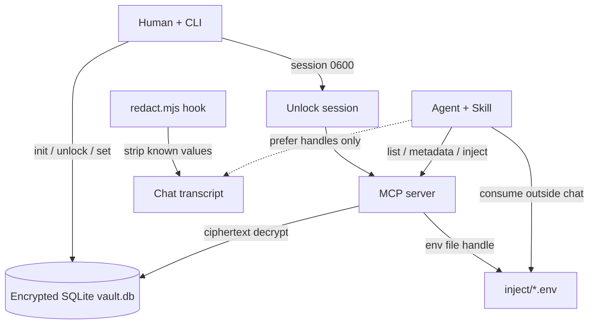

# Password Space

**A local encrypted credential vault for developers and AI agents.**

Store secrets once. Unlock them explicitly. Let agents access credentials through MCP without routinely exposing secret values in chat transcripts.

> Encryption at rest and MCP inject handles reduce how often secrets appear in chat — they do **not** make secrets invisible to a compromised machine, a stolen unlock session, or every possible log/tool path. See [Security model](#security-model) and [SECURITY.md](./SECURITY.md).

## Why Password Space?

| Anti-pattern | What goes wrong |
| --- | --- |
| Paste secrets into chat | Persist in transcripts, screenshots, logs |
| Commit `.env` files | Leak via git and shared workspaces |
| Plaintext MCP configs | Readable by anything with config access |

Password Space keeps **ciphertext on disk**, a **human unlock** gate, and an **agent side channel** (MCP + short-lived inject files + Skill + optional redaction hook).

## Features

| Feature | What it does |
| --- | --- |
| Encrypted local storage | Secrets in SQLite (`vault.db`), AES-256-GCM under a passphrase-wrapped vault key |
| Explicit unlock | Human runs `unlock` before CLI/MCP can use the vault; `lock` clears the session |
| Metadata-only listing | `list` / MCP `list_secrets` return names, ids, tags — not values |
| MCP tools | `list_secrets`, `get_secret_metadata`, `inject_secret` (preferred), `resolve_secret` (last resort) |
| Secret injection | `inject_secret` writes a short-lived `0600` env file and returns a handle + path — not the value |
| Session TTL | Unlock session expires (default **8 hours**); expired sessions are rejected and cleared |
| Redaction hook | Optional `beforeSubmitPrompt` hook strips **known** inject values from outbound prompts |

When the vault is **locked**, CLI mutating/read commands and MCP tools fail until a human unlocks again. Restarting the MCP process does not unlock the vault — it only re-reads an existing valid session file.

## Security model

**Designed to protect:** vault database on disk while locked (ciphertext + wrapped key); chat/transcript plane when agents use `inject_secret` and follow the Skill (handles like `ps://NAME` instead of values).

**Does not protect against:** an attacker on the same unlocked user account; theft of a live session file; plaintext while present in process memory, inject `*.env` files, or CLI `get` / `resolve_secret` results; hooks that are disabled, misconfigured, or incomplete.

| Area | MVP behavior |
| --- | --- |
| KDF / encryption | scrypt (N=2¹⁵, r=8, p=1) + AES-256-GCM via Node `crypto` — see [SECURITY.md](./SECURITY.md) |
| Unlock session | `$PASSWORD_SPACE_HOME/session`, mode `0600`, default TTL 8h; `lock` deletes it |
| Inject files | `$PASSWORD_SPACE_HOME/inject/<token>.env`, mode `0600`, default TTL **5 minutes** (consume then delete) |
| Passphrase loss | **No recovery** — ciphertext is unrecoverable without the unlock passphrase |
| Redaction | Only **known** values from inject files / explicit secret lists — not a universal DLP |

Full threat model, trust boundaries, and reporting: **[SECURITY.md](./SECURITY.md)**. Architecture / key hierarchy: **[docs/architecture.md](./docs/architecture.md)**.

## Requirements

| Requirement | Notes |
| --- | --- |
| Node.js | **≥ 20** (uses built-in `node:sqlite`) |
| Package manager | **pnpm** 9.x (`packageManager` field in `package.json`) |
| OS | Developed and verified on **macOS**; should run anywhere Node 20 + `node:sqlite` works — treat Linux/Windows as **best-effort** until listed here as tested |
| Cursor plugin | Cursor with marketplace / MCP support; **CLI unlock still required** |

## Quickstart (CLI)

```bash
git clone https://github.com/vishnutvm/password-space.git
cd password-space
pnpm install && pnpm build

pnpm password-space init          # interactive passphrase (min 8 chars)
pnpm password-space unlock        # writes session file
pnpm password-space set GITHUB_TOKEN --tags api,github   # prompts for value on a TTY
pnpm password-space list          # names / tags only
pnpm password-space status
pnpm password-space lock
```

### How `set` reads the secret value

| Input | When |
| --- | --- |
| Interactive hidden prompt | TTY and no `--value` |
| stdin (one value) | Non-TTY (pipes) |
| `--value <text>` | Explicit flag (avoid in shell history for real secrets) |

Prefer piping from a protected source rather than putting a real token on the command line:

```bash
printf '%s' "$GITHUB_TOKEN" | pnpm password-space set GITHUB_TOKEN --tags api,github
```

`pnpm build` also regenerates the marketplace MCP bundle at `plugins/password-space/dist/index.js`.

### Throwaway demo

```bash
export PASSWORD_SPACE_HOME=/tmp/ps-demo
rm -rf "$PASSWORD_SPACE_HOME"

# WARNING: inline PASSWORD_SPACE_PASSPHRASE is for demos only — it can end up in shell history.
# Do not use this pattern with a real vault passphrase.
PASSWORD_SPACE_PASSPHRASE='demo-pass-ok' pnpm password-space init
PASSWORD_SPACE_PASSPHRASE='demo-pass-ok' pnpm password-space unlock
printf 'ghp_demo_secret_value' | pnpm password-space set DEMO_TOKEN --tags demo
pnpm password-space list
pnpm password-space status
pnpm password-space lock
```

Or run `pnpm demo` (throwaway vault under `/tmp/password-space-demo`).

## Cursor integration

Marketplace install registers **MCP + Skill + hooks**. It does **not** unlock the vault.

1. Open **Cursor Settings → Customize** (or **Dashboard → Plugins & MCPs** for team marketplaces).
2. **+ Add Marketplace** → **Import from GitHub**.
3. Paste: `https://github.com/vishnutvm/password-space`
4. Install the **password-space** plugin.
5. Optional: **Plugins → Configure** → `PASSWORD_SPACE_HOME` (empty = `~/.password-space`).
6. From a local clone: `pnpm install && pnpm build`, then `pnpm password-space init` (once) and `pnpm password-space unlock` each session.

Official public listing (later): [cursor.com/marketplace/publish](https://cursor.com/marketplace/publish).

Layout: `.cursor-plugin/marketplace.json` → `plugins/password-space/`.

## Manual MCP configuration

Without the marketplace, point Cursor (or another MCP client) at the bundled server:

```json
{
  "mcpServers": {
    "password-space": {
      "command": "node",
      "args": ["/absolute/path/to/password-space/plugins/password-space/dist/index.js"],
      "env": {
        "PASSWORD_SPACE_HOME": "/home/you/.password-space"
      }
    }
  }
}
```

Also see [`examples/mcp.cursor.json`](./examples/mcp.cursor.json). Skill: `plugins/password-space/skills/password-space/`. Hooks: `plugins/password-space/hooks/hooks.json`.

### MCP tools

| Tool | Returns secret value? | Use |
| --- | --- | --- |
| `list_secrets` | No | Discover names / ids / tags |
| `get_secret_metadata` | No | One secret’s metadata |
| `inject_secret` | **No** (writes env file) | **Preferred** agent access |
| `resolve_secret` | Yes, if `confirm_redaction: true` | Last resort only |

## Secret-injection lifecycle

This is the intended agent path (conversation plane stays on refs; runtime plane reads a file).

```text
1. Human: password-space unlock
2. Agent: list_secrets / get_secret_metadata   → names only
3. Agent: inject_secret({ name })
4. MCP: decrypt in-process → write inject/<token>.env (0600)
5. Tool result: handle + env_file path + env_var + expires_at  (no value)
6. Runtime: source/read env file outside chat → use credential
7. Runtime: delete env file when done
8. Human: password-space lock when finished
```

| Question | Answer |
| --- | --- |
| What does `inject_secret` return? | JSON with `handle` (`ps://NAME`), `env_file` (absolute path), `env_var`, `expires_at`, `redact_in_transcript: true` — **not** the secret value |
| Where is the file? | `$PASSWORD_SPACE_HOME/inject/<random>.env` |
| Permissions? | Written with mode `0600` (best-effort `chmod`) |
| How to use without printing? | Read/source the file in a shell or tool runtime; do **not** `cat` it into chat |
| When deleted? | Caller should delete after use; TTL metadata defaults to **5 minutes** (file is not auto-swept by a daemon in MVP) |
| Vault locked / missing secret? | Tool returns an error payload (`Vault is locked…` / `Secret not found…`); no env file is written |

Avoid CLI `get` and MCP `resolve_secret` in agent workflows — both can put plaintext into the tool/CLI result stream.

## Architecture



**Key hierarchy:** passphrase → scrypt(salt) → unwrap vault key → AES-256-GCM per secret.

Detail: [docs/architecture.md](./docs/architecture.md).

## Troubleshooting

| Symptom | Likely cause | What to do |
| --- | --- | --- |
| `node:sqlite` / build failures | Node &lt; 20 | Upgrade to Node 20+ (`node -v`) |
| `Vault not initialized` | No `init` yet | `pnpm password-space init` |
| `Vault is locked` / `No unlock session` | Locked or expired session | `pnpm password-space unlock` |
| `Unlock session expired` | TTL elapsed (default 8h) | Unlock again; use `--ttl <hours>` if you need longer |
| `Wrong passphrase` | Typo or wrong vault | Confirm `PASSWORD_SPACE_HOME` matches the vault you meant |
| Plugin installed but MCP errors “locked” | Marketplace ≠ unlock | Unlock via CLI in the same `PASSWORD_SPACE_HOME` |
| Secret not found | Wrong name / empty vault | `pnpm password-space list` (after unlock) |
| Unexpected data dir | Env override | Check `PASSWORD_SPACE_HOME` / plugin variable; `pnpm password-space status` |
| MCP won’t start | Bad path to `dist/index.js` | `pnpm build`, then point at `plugins/password-space/dist/index.js` |

## Development

```bash
pnpm install && pnpm build && pnpm test
```

| Path | Role |
| --- | --- |
| `packages/vault` | Crypto, store, session, inject, redact |
| `packages/cli` | Human CLI |
| `packages/mcp-server` | MCP server sources |
| `plugins/password-space` | Cursor plugin (bundled MCP + skill + hooks + logo) |

See [CONTRIBUTING.md](./CONTRIBUTING.md). License: [MIT](./LICENSE).
