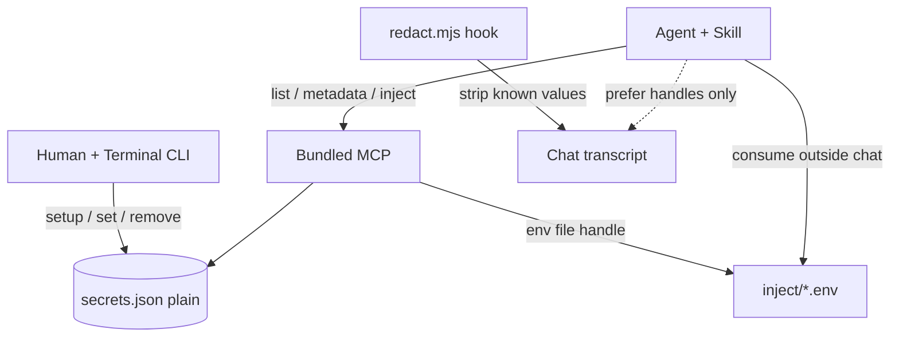

# Password Space

**A local plain-text named secret store for developers and AI agents.**

Store secrets once by name in Terminal. Let agents access credentials through MCP (`inject_secret`) without pasting values into chat transcripts.

> Values are stored as **local plain files** (mode `0600`) under `~/.password-space`. That keeps secrets out of chat — it does **not** hide them from anyone with access to your user account or disk. See [Security model](#security-model) and [SECURITY.md](./SECURITY.md).

## Why Password Space?

| Anti-pattern | What goes wrong |
| --- | --- |
| Paste secrets into chat | Persist in transcripts, screenshots, logs |
| Commit `.env` files | Leak via git and shared workspaces |
| Re-type tokens into every agent turn | Friction + accidental leaks |

Password Space keeps **named secrets on disk**, a **Terminal-only** human path for add/remove, and an **agent side channel** (MCP inject by name + Skill + optional redaction hook).

## Features

| Feature | What it does |
| --- | --- |
| Plain local storage | Secrets in `secrets.json` (mode `0600`) under `~/.password-space` |
| No unlock gate | Lock / unlock / passphrase are **not** required for the happy path |
| Metadata-only listing | `list` / MCP `list_secrets` return names, ids, tags — not values |
| Day-1 Terminal + MCP | Terminal `setup` / `set` for secrets; MCP `vault_status`, `list_secrets`, `inject_secret` |
| Secret injection | `inject_secret` writes a short-lived `0600` env file and returns a handle + path — not the value |
| Redaction hook | Optional `beforeSubmitPrompt` hook strips **known** inject values from outbound prompts |
| Bundled plugin MCP + CLI | `plugins/password-space/dist/index.js` (MCP) and `dist/cli.js` (Terminal) — Node only, no clone |

## Security model

**Designed to protect:** chat/transcript plane when agents use `inject_secret` / tool-arg secrets and follow the Skill (handles like `ps://NAME` instead of values).

**Does not protect against:** anyone who can read your user files; plaintext on disk in `secrets.json`; plaintext in process memory, inject `*.env` files, or CLI `get` / `resolve_secret` results; hooks that are disabled, misconfigured, or incomplete.

| Area | MVP behavior |
| --- | --- |
| At rest | Plain JSON at `$PASSWORD_SPACE_HOME/secrets.json`, mode `0600` |
| Inject files | `$PASSWORD_SPACE_HOME/inject/<token>.env`, mode `0600`, default TTL **5 minutes** |
| Redaction | Only **known** values from inject files / explicit secret lists — not a universal DLP |

Full threat model: **[SECURITY.md](./SECURITY.md)**. Architecture: **[docs/architecture.md](./docs/architecture.md)**.

## Requirements

| Requirement | Notes |
| --- | --- |
| Node.js | **≥ 20** — required to run the bundled MCP |
| Cursor plugin | Cursor with marketplace / MCP support |
| Package manager | **pnpm** 9.x — **optional**; only for developing this repo |
| OS | Developed and verified on **macOS**; Linux/Windows best-effort |

## Quickstart (Cursor plugin + Terminal)

**[External user install](./docs/EXTERNAL_USER_INSTALL.md)** · **[Getting started in 2 minutes](./docs/onboarding.md)**

1. Open **Cursor Settings → Customize** (or **Dashboard → Plugins & MCPs** for team marketplaces).
2. **+ Add Marketplace** → **Import from GitHub**.
3. Paste: `https://github.com/vishnutvm/password-space`
4. Install the **password-space** plugin and reload Cursor.
5. Store home defaults to **`~/.password-space`**. Optional override: a **real** absolute `PASSWORD_SPACE_HOME`. There is **no** Plugins → Configure UI for this.
6. Run **`/setup-password-space`** in chat, or ask the agent to run **`vault_onboard`**.
7. Follow `primary_action` — open **Terminal** and run `copy_paste_command`:
   ```bash
   node "${CURSOR_PLUGIN_ROOT}/dist/cli.js" setup   # ensure store
   node "${CURSOR_PLUGIN_ROOT}/dist/cli.js" set     # name + hidden value
   node "${CURSOR_PLUGIN_ROOT}/dist/cli.js"         # interactive menu
   ```
   Secret values are typed at **hidden** prompts. There is **no App UI** for add.

```text
vault_onboard → Terminal: …/dist/cli.js setup → …/dist/cli.js set → vault_status / list_secrets → inject_secret
```

Pass **secret name + value** in **Terminal** — **never** in chat. MCP tools handle status / list / inject by name. Vault Manager is optional status UI only.

Official public listing (later): [cursor.com/marketplace/publish](https://cursor.com/marketplace/publish).

Layout: `.cursor-plugin/marketplace.json` → `plugins/password-space/` (ships `dist/index.js` + `dist/cli.js`).

## CLI (setup / add / remove — primary path)

### External users (plugin-bundled — preferred)

After installing the marketplace plugin and reloading Cursor:

```bash
node "${CURSOR_PLUGIN_ROOT}/dist/cli.js" setup    # ensure ~/.password-space/secrets.json
node "${CURSOR_PLUGIN_ROOT}/dist/cli.js" set      # prompts for name, then hidden value
node "${CURSOR_PLUGIN_ROOT}/dist/cli.js" set GITHUB_TOKEN --tags api,github
node "${CURSOR_PLUGIN_ROOT}/dist/cli.js" list     # names / tags only
node "${CURSOR_PLUGIN_ROOT}/dist/cli.js" status
node "${CURSOR_PLUGIN_ROOT}/dist/cli.js" remove
```

If `vault_onboard` returns an absolute path to `cli.js`, prefer that paste command.

### Contributors (optional clone)

```bash
git clone https://github.com/vishnutvm/password-space.git
cd password-space
pnpm install && pnpm build
pnpm password-space setup
```

### How `set` reads the secret value

| Input | When |
| --- | --- |
| Interactive name + hidden value | TTY, no name arg and/or no `--value` |
| stdin (one value) | Non-TTY (pipes) with name on argv |
| `--value <text>` | Explicit flag (avoid in shell history for real secrets) |

```bash
printf '%s' "$GITHUB_TOKEN" | node "${CURSOR_PLUGIN_ROOT}/dist/cli.js" set GITHUB_TOKEN --tags api,github
```

`pnpm build` regenerates the marketplace bundles at `plugins/password-space/dist/index.js` (MCP) and `plugins/password-space/dist/cli.js` (Terminal CLI).

### Throwaway demo

```bash
export PASSWORD_SPACE_HOME=/tmp/ps-demo
rm -rf "$PASSWORD_SPACE_HOME"

pnpm password-space setup
printf 'ghp_demo_secret_value' | pnpm password-space set DEMO_TOKEN --tags demo
pnpm password-space list
pnpm password-space status
```

Or run `pnpm demo` (throwaway store under `/tmp/password-space-demo`).

## Manual MCP configuration

Without the marketplace, point Cursor (or another MCP client) at the **bundled** server:

```json
{
  "mcpServers": {
    "password-space": {
      "command": "node",
      "args": ["/absolute/path/to/password-space/plugins/password-space/dist/index.js"]
    }
  }
}
```

`PASSWORD_SPACE_HOME` is optional — omit `env` for the default `~/.password-space`.

Also see [`examples/mcp.cursor.json`](./examples/mcp.cursor.json). Skill: `plugins/password-space/skills/password-space/`. Hooks: `plugins/password-space/hooks/hooks.json`.

### MCP tools

| Tool | Returns secret value? | Use |
| --- | --- | --- |
| `vault_onboard` | No | Guided next step (`primary_action`) |
| `vault_status` | No | Store ready? Next step hint |
| `vault_init` | No | Soft-compat: ensure store (prefer Terminal setup) |
| `vault_unlock` / `vault_lock` | No | Soft-compat no-ops (not required) |
| `vault_set_secret` | **No** (metadata only) | Prefer Terminal `set` for humans |
| `list_secrets` | No | Discover names / ids / tags |
| `get_secret_metadata` | No | One secret’s metadata |
| `inject_secret` | **No** (writes env file) | **Preferred** agent access by name |
| `resolve_secret` | Yes, if `confirm_redaction: true` | Last resort only |

## Secret-injection lifecycle

```text
1. Human: Terminal setup → set (name + hidden value)
2. Agent: list_secrets / get_secret_metadata   → names only
3. Agent: inject_secret({ name })
4. MCP: read store → write inject/<token>.env (0600)
5. Tool result: handle + env_file path + env_var + expires_at  (no value)
6. Runtime: source/read env file outside chat → use credential
7. Runtime: delete env file when done
```

| Question | Answer |
| --- | --- |
| What does `inject_secret` return? | JSON with `handle` (`ps://NAME`), `env_file`, `env_var`, `expires_at`, `redact_in_transcript: true` — **not** the secret value |
| Where is the file? | `$PASSWORD_SPACE_HOME/inject/<random>.env` |
| Permissions? | Written with mode `0600` |
| How to use without printing? | Read/source the file in a shell or tool runtime; do **not** `cat` it into chat |

Avoid CLI `get` and MCP `resolve_secret` in agent workflows — both can put plaintext into the tool/CLI result stream.

## Architecture



Detail: [docs/architecture.md](./docs/architecture.md).

## Migrating from the encrypted vault

Older releases used an encrypted SQLite `vault.db` plus unlock sessions. That file is **never deleted or auto-migrated**.

1. Keep your old `~/.password-space/vault.db` as a backup if you still need it.
2. Run Terminal `setup` to create `secrets.json`.
3. Re-add each secret with Terminal `set` (name + hidden value).
4. Ask the agent to use secrets by name via `inject_secret`.

## Troubleshooting

| Symptom | Likely cause | What to do |
| --- | --- | --- |
| MCP fails to start | Node &lt; 20 | Upgrade to Node 20+ (`node -v`) |
| Store not initialized | No setup yet | Terminal `setup` or follow `vault_onboard` |
| Secret not found | Wrong name / empty store | `list_secrets` after Terminal `set` |
| Unexpected data dir | Env override or unresolved `${…}` | Check `PASSWORD_SPACE_HOME`; `vault_status` shows `data_dir` |
| Legacy `vault.db` present | Pre-plain-text install | Re-add secrets with `set`; old DB left untouched |

## Development

```bash
pnpm install && pnpm build && pnpm test
```

| Path | Role |
| --- | --- |
| `packages/vault` | Plain store, inject, redact |
| `packages/cli` | Human Terminal CLI |
| `packages/mcp-server` | MCP server sources (bundled into the plugin) |
| `plugins/password-space` | Cursor plugin (bundled MCP + CLI + skill + hooks + logo) |

See [CONTRIBUTING.md](./CONTRIBUTING.md). License: [MIT](./LICENSE).
