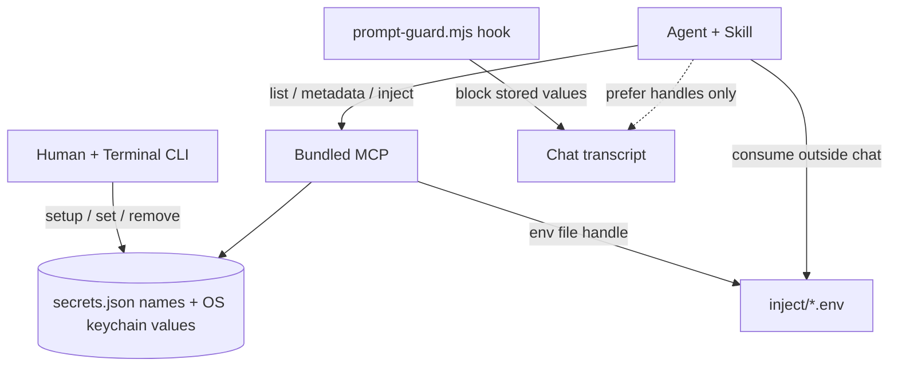

# Password Space

**A local named secret store for developers and AI agents, backed by your OS keychain.**

Store secrets once by name in Terminal. Agents use them by name — `password-space run -s NAME -- <command>` puts the value straight into the command's environment — without the value ever passing through chat.

> Secret values live in the **macOS Keychain, Windows Credential Manager or Linux Secret Service**. `~/.password-space/secrets.json` keeps only names, tags and notes. On a machine with no keychain, values fall back to `secrets.json` in plain text (mode `0600`) and every status screen says so. See [Storage](#storage), [Security model](#security-model) and [SECURITY.md](./SECURITY.md).

## Why Password Space?

| Anti-pattern | What goes wrong |
| --- | --- |
| Paste secrets into chat | Persist in transcripts, screenshots, logs |
| Commit `.env` files | Leak via git and shared workspaces |
| Re-type tokens into every agent turn | Friction + accidental leaks |

Password Space keeps **named secrets on disk**, a **Terminal-only** human path for add/remove, and an **agent side channel** (MCP inject by name + Skill + optional redaction hook).

## Features

| Feature | What it does |
| --- | --- |
| OS keychain storage | Values in the OS keychain; names and metadata in `secrets.json`. Plain-file fallback where no keychain exists |
| No unlock gate | Lock / unlock / passphrase are **not** required for the happy path |
| Metadata-only listing | `list` / MCP `list_secrets` return names, ids, tags — not values |
| Day-1 Terminal + MCP | Terminal `setup` / `set` for secrets; MCP `vault_status`, `list_secrets`, `inject_secret` |
| Secret injection | `inject_secret` writes a short-lived `0600` env file and returns a handle + path — not the value |
| Prompt hook | Cursor and Claude Code hooks block outbound prompts that contain **any stored** secret value |
| `run` command | `password-space run -s NAME -- <cmd>` passes secrets in the command's env and redacts them from its output |
| Bundled plugin MCP + CLI | `plugins/password-space/dist/index.js` (MCP) and `dist/cli.js` (Terminal) — Node only, no clone |

## Security model

**Designed to protect:** chat/transcript plane when agents use `inject_secret` / tool-arg secrets and follow the Skill (handles like `ps://NAME` instead of values).

**Does not protect against:** malware, or an agent running as your user that deliberately works around it (for example obfuscated keychain commands, `get` inside a pseudo-terminal, or sourcing an inject file and printing it); plaintext in process memory; a command that encodes or sends its own environment; hooks that are disabled. With the file fallback, anyone who can read your user files can read `secrets.json`. See [SECURITY.md](./SECURITY.md#what-an-agent-with-shell-access-can-still-do).

**Closed by default for agents:** CLI `get` only prints to an interactive terminal; `run --no-redact` needs a terminal; `resolve_secret` is not even listed unless you set `PASSWORD_SPACE_ENABLE_RESOLVE=1`; inject files live 60 seconds and are deleted when the MCP server exits; tool hooks block `get`, direct keychain lookups and reads of `secrets.json` / inject files.

| Area | MVP behavior |
| --- | --- |
| At rest | Values in the OS keychain (service `password-space`). `secrets.json` (mode `0600`) has names, tags, notes and keyed fingerprints. File fallback: values in `secrets.json` |
| Inject files | `$PASSWORD_SPACE_HOME/inject/<token>.env`, dir `0700`, file `0600`, default TTL **60 seconds**, deleted at expiry and when the MCP server exits |
| Prompt hooks | Cursor and Claude Code prompts that contain **any stored value** are blocked (values of 6+ characters) |
| `run` output | Values are replaced with `[REDACTED]` in the command's output when it is not a terminal |

Full threat model: **[SECURITY.md](./SECURITY.md)**. Architecture: **[docs/architecture.md](./docs/architecture.md)**.

## Requirements

| Requirement | Notes |
| --- | --- |
| Node.js | **≥ 20** — required to run the bundled MCP |
| Cursor plugin | Cursor with marketplace / MCP support |
| Claude Code plugin | Claude Code with plugin support — see [docs/claude-code.md](./docs/claude-code.md) |
| Package manager | **pnpm** 9.x — **optional**; only for developing this repo |
| OS | Developed and verified on **macOS**; Linux/Windows best-effort |

## Quickstart (Cursor plugin + Terminal)

**[External user install](./docs/EXTERNAL_USER_INSTALL.md)** · **[Getting started in 2 minutes](./docs/onboarding.md)**

1. Open **Cursor Settings → Customize** (or **Dashboard → Plugins & MCPs** for team marketplaces).
2. **+ Add Marketplace** → **Import from GitHub**.
3. Paste: `https://github.com/vishnutvm/password-space`
4. Install the **password-space** plugin and reload Cursor.
5. Store home defaults to **`~/.password-space`**. Optional override: a **real** absolute `PASSWORD_SPACE_HOME`. There is **no** Plugins → Configure UI for this.
6. Run **`/setup-password-space`** in chat, or ask the agent to run **`vault_onboard`**.
7. Follow `primary_action` — open **Terminal** and run `copy_paste_command`:
   ```bash
   node "${CURSOR_PLUGIN_ROOT}/dist/cli.js" setup   # ensure store
   node "${CURSOR_PLUGIN_ROOT}/dist/cli.js" set     # name + hidden value
   node "${CURSOR_PLUGIN_ROOT}/dist/cli.js"         # interactive menu
   ```
   Secret values are typed at **hidden** prompts. There is **no App UI** for add.

```text
vault_onboard → Terminal: …/dist/cli.js setup → …/dist/cli.js set → vault_status / list_secrets → inject_secret
```

Pass **secret name + value** in **Terminal**, or hand a key to your agent once and it saves it with `store_secret` (see below). MCP tools handle status / list / use by name. Vault Manager is optional status UI only.

Official public listing (later): [cursor.com/marketplace/publish](https://cursor.com/marketplace/publish).

Layout: `.cursor-plugin/marketplace.json` → `plugins/password-space/` (ships `dist/index.js` + `dist/cli.js`).

## Quickstart (Claude Code)

```text
/plugin marketplace add vishnutvm/password-space
/plugin install password-space@password-space-marketplace
```

Restart Claude Code, then run `/password-space:setup-password-space`. Hooks, what differs from Cursor, and manual setup: **[docs/claude-code.md](./docs/claude-code.md)**.

## CLI (setup / add / remove — primary path)

### External users (plugin-bundled — preferred)

After installing the marketplace plugin and reloading Cursor:

```bash
node "${CURSOR_PLUGIN_ROOT}/dist/cli.js" setup    # ensure ~/.password-space/secrets.json
node "${CURSOR_PLUGIN_ROOT}/dist/cli.js" set      # prompts for name, then hidden value
node "${CURSOR_PLUGIN_ROOT}/dist/cli.js" set GITHUB_TOKEN --tags api,github
node "${CURSOR_PLUGIN_ROOT}/dist/cli.js" list     # names / tags only
node "${CURSOR_PLUGIN_ROOT}/dist/cli.js" status
node "${CURSOR_PLUGIN_ROOT}/dist/cli.js" remove
```

If `vault_onboard` returns an absolute path to `cli.js`, prefer that paste command.

### From npm

The Terminal CLI is published as [`password-space`](https://www.npmjs.com/package/password-space) once a release has gone out:

```bash
npm install -g password-space
password-space setup
password-space set GITHUB_TOKEN
```

### Contributors (optional clone)

```bash
git clone https://github.com/vishnutvm/password-space.git
cd password-space
pnpm install && pnpm build
pnpm password-space setup
```

### How `set` reads the secret value

| Input | When |
| --- | --- |
| Interactive name + hidden value | TTY, no name arg and/or no `--value` |
| stdin (one value) | Non-TTY (pipes) with name on argv |
| `--value <text>` | Explicit flag (avoid in shell history for real secrets) |

```bash
printf '%s' "$GITHUB_TOKEN" | node "${CURSOR_PLUGIN_ROOT}/dist/cli.js" set GITHUB_TOKEN --tags api,github
```

`pnpm build` regenerates the marketplace bundles at `plugins/password-space/dist/index.js` (MCP) and `plugins/password-space/dist/cli.js` (Terminal CLI).

### Throwaway demo

```bash
export PASSWORD_SPACE_HOME=/tmp/ps-demo
rm -rf "$PASSWORD_SPACE_HOME"

pnpm password-space setup
printf 'ghp_demo_secret_value' | pnpm password-space set DEMO_TOKEN --tags demo
pnpm password-space list
pnpm password-space status
```

Or run `pnpm demo` (throwaway store under `/tmp/password-space-demo`).

## Manual MCP configuration

Without the marketplace, point Cursor (or another MCP client) at the **bundled** server:

```json
{
  "mcpServers": {
    "password-space": {
      "command": "node",
      "args": ["/absolute/path/to/password-space/plugins/password-space/dist/index.js"]
    }
  }
}
```

`PASSWORD_SPACE_HOME` is optional — omit `env` for the default `~/.password-space`.

Also see [`examples/mcp.cursor.json`](./examples/mcp.cursor.json). Skill: `plugins/password-space/skills/password-space/`. Hooks: `plugins/password-space/hooks/hooks.json`.

### Hand a key to your agent once

If you would rather not use Terminal, give the key to your agent one time, for example
*"here is my GitHub token, save it as GITHUB_TOKEN: ghp_…"*. The agent calls `store_secret`,
the value goes to your OS keychain, and from then on every session finds it with `list_secrets`
and uses it by name through `run -s GITHUB_TOKEN -- <command>`. You don't paste it again.

- The value is never returned by any tool result except `resolve_secret`, which is off unless you set `PASSWORD_SPACE_ENABLE_RESOLVE=1`, and errors are scrubbed of it.
- An existing name is never replaced unless the agent passes `overwrite: true` (for a rotated key).
- `remove_secret` deletes a secret by name when you ask the agent to forget it.
- Every add, update and remove is written to `~/.password-space/audit.jsonl` with the name and actor (`mcp-agent`), never the value.
- The copy you pasted stays in that chat's history. Use Terminal `set` for keys that should never touch a chat.
- macOS limits keychain values to about 1,900 bytes and Windows to 2,560; longer values are refused with that message.

### MCP tools

| Tool | Returns secret value? | Use |
| --- | --- | --- |
| `vault_onboard` | No | Guided next step (`primary_action`) |
| `vault_status` | No | Store ready? Next step hint |
| `store_secret` | **No** (metadata + how to use it by name) | Agent saves a key the user handed over. `overwrite: true` to replace. Alias: `vault_set_secret` |
| `remove_secret` | No | Agent deletes a secret by name. Alias: `vault_delete_secret` |
| `list_secrets` | No | Discover names / ids / tags. Agents check this before asking for a key |
| `get_secret_metadata` | No | One secret’s metadata |
| `inject_secret` | **No** (writes env file) | Agent access by name when the CLI `run` command cannot be used |
| `resolve_secret` | Yes, if `confirm_redaction: true` | **Off by default**: only listed when you set `PASSWORD_SPACE_ENABLE_RESOLVE=1` in the MCP server env |

## Storage

| Platform | Where values go | Tool used (no native Node addon) |
| --- | --- | --- |
| macOS | Login Keychain, service `password-space` | `/usr/bin/security` |
| Windows | Credential Manager, targets `password-space:*` | `powershell.exe` calling `advapi32` `Cred*` |
| Linux | Secret Service (GNOME Keyring, KWallet, ...) | `secret-tool` from `libsecret-tools` |

Values are always passed to these tools on stdin, never on the command line. Windows limits one
credential to 2,560 bytes and the macOS helper to about 1,900 bytes; longer values (such as
large PEM keys) are refused with a clear error. Use `PASSWORD_SPACE_STORAGE=file` for those.
`setup` picks the backend once, when it creates the store:

- `PASSWORD_SPACE_STORAGE=auto` (default): use the keychain if a test write works, else fall back to plain `secrets.json` and show why.
- `PASSWORD_SPACE_STORAGE=keychain`: fail instead of falling back.
- `PASSWORD_SPACE_STORAGE=file`: never use the keychain (plain text on disk).

`password-space status` shows which one is in use.

**Upgrading from plain `secrets.json`.** Existing stores keep working as they are. Run
`password-space migrate` (or answer yes when `setup` offers it) to move every value into the
keychain. Each value is written, read back and compared before `secrets.json` is rewritten
without values; if anything fails, the file is left as it was. `password-space migrate --to file`
moves values back.

**Linux without a desktop session** (servers, containers, WSL) usually has no Secret Service, so
the store falls back to the file. Install `libsecret-tools` and run `gnome-keyring-daemon` inside a
D-Bus session if you want the keychain there.

## Running commands with secrets

```bash
password-space run -s GITHUB_TOKEN -- gh repo list
password-space run -s OPENAI_API_KEY=openai-prod -s DATABASE_URL -- npm test
password-space run --all -- ./deploy.sh
```

`run` reads the named secrets and starts the command (without a shell) with them in its
environment. The agent only ever sees the secret's name. When output is not a terminal, which
is how agents run commands, any secret value the command prints is replaced with `[REDACTED]`;
`--no-redact` turns that off. Agents should prefer `run` to `inject_secret`, which writes the
value to a temporary file.

## Secret-injection lifecycle

```text
1. Human: Terminal setup → set (name + hidden value)
2. Agent: list_secrets / get_secret_metadata   → names only
3. Agent: inject_secret({ name })
4. MCP: read store → write inject/<token>.env (0600)
5. Tool result: handle + env_file path + env_var + expires_at  (no value)
6. Runtime: source/read env file outside chat → use credential
7. Runtime: delete env file when done
```

| Question | Answer |
| --- | --- |
| What does `inject_secret` return? | JSON with `handle` (`ps://NAME`), `env_file`, `env_var`, `expires_at`, `redact_in_transcript: true` — **not** the secret value |
| Where is the file? | `$PASSWORD_SPACE_HOME/inject/<random>.env` |
| Permissions? | Written with mode `0600` |
| How to use without printing? | Source it in the same command: `set -a; . FILE; set +a; <command>`. The tool hooks block `cat`, `grep` and `Read` on it |
| How long does it live? | 60 seconds. The MCP server deletes it at expiry and when it exits |

CLI `get` refuses to print without an interactive terminal, and `resolve_secret` is off unless you opt in, so agents use `run` or `inject_secret`.

## Architecture



Detail: [docs/architecture.md](./docs/architecture.md).

## Migrating from the encrypted vault

Older releases used an encrypted SQLite `vault.db` plus unlock sessions. That file is **never deleted or auto-migrated**.

1. Keep your old `~/.password-space/vault.db` as a backup if you still need it.
2. Run Terminal `setup` to create the new store.
3. Re-add each secret with Terminal `set` (name + hidden value).
4. Ask the agent to use secrets by name (`run -s NAME -- <command>`).

## Troubleshooting

| Symptom | Likely cause | What to do |
| --- | --- | --- |
| MCP fails to start | Node &lt; 20 | Upgrade to Node 20+ (`node -v`) |
| Store not initialized | No setup yet | Terminal `setup` or follow `vault_onboard` |
| Secret not found | Wrong name / empty store | `list_secrets` after Terminal `set` |
| Unexpected data dir | Env override or unresolved `${…}` | Check `PASSWORD_SPACE_HOME`; `vault_status` shows `data_dir` |
| Legacy `vault.db` present | Pre-plain-text install | Re-add secrets with `set`; old DB left untouched |

## Development

```bash
pnpm install && pnpm build && pnpm test
```

| Path | Role |
| --- | --- |
| `packages/vault` | Store, OS keychain backends, prompt guard, inject, redact |
| `packages/cli` | Human Terminal CLI, published to npm as `password-space` |
| `packages/mcp-server` | MCP server sources (bundled into the plugin) |
| `plugins/password-space` | Cursor and Claude Code plugin (bundled MCP + CLI + skill + hooks + logo) |
| `hooks/` | Portable redaction wrapper (same code as the plugin hook, opt-in defaults) |

See [CONTRIBUTING.md](./CONTRIBUTING.md). Changes: [CHANGELOG.md](./CHANGELOG.md). Releases: [docs/RELEASING.md](./docs/RELEASING.md). License: [MIT](./LICENSE).
