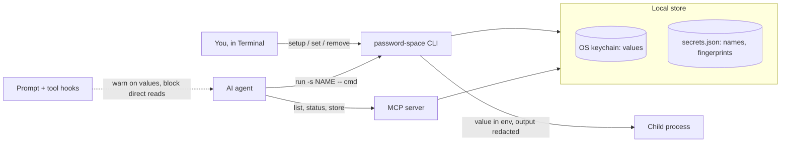

# Password Space

[](https://github.com/vishnutvm/password-space/actions/workflows/ci.yml)
[](https://github.com/vishnutvm/password-space/actions/workflows/keychain.yml)
[](./LICENSE)


**Give AI coding agents your API keys by name, not by pasting them into chat.**

Password Space is a local secret store for developers who work with AI agents
(Claude Code, Cursor, OpenAI Codex). You save a secret once in your Terminal.
Your agent sees only its name, and runs commands like

```bash
password-space run -s GITHUB_TOKEN -- gh repo list
```

which puts the value straight into that command's environment and scrubs it
from the output. Values live in your OS keychain, and hooks stop a prompt from
being sent if it contains one.

## Why

Agents need credentials to do real work: call an API, push a package, query a
database. The usual ways to hand them over all leak:

| What people do | What goes wrong |
| --- | --- |
| Paste the key into chat | It is stored in the transcript, logs and screenshots for good |
| Commit or share a `.env` file | It ends up in git history and shared workspaces |
| Re-type it every session | Friction, and sooner or later it gets pasted somewhere it shouldn't |

Password Space keeps the value on your machine and gives the agent a name to
work with instead.

## Features

- **OS keychain storage.** Values go to the macOS Keychain, Windows Credential
  Manager or Linux Secret Service, using the system tools (no native Node
  addon). `secrets.json` keeps only names, tags, notes and keyed fingerprints.
- **`run` by name.** `run -s NAME -- <cmd>` starts the command without a shell,
  with the secret in its environment, and replaces the value with `[REDACTED]`
  in output that is not a terminal (which is how agents run commands).
- **MCP server for agents.** List secret names, check status, save a key the
  user hands over (`store_secret`), and get the exact `run` command to use.
  No tool returns a value by default.
- **Prompt and tool hooks.** Warn when a prompt contains a stored value (the
  prompt still goes through and the agent is told to use it by name), and
  block agent commands that would read a value directly (`get`, keychain
  lookups, reading the store or inject files).
- **One plugin, three hosts.** The same bundled folder works as a Claude Code
  plugin, a Cursor plugin, and in Codex via `codex-setup`.
- **Audit log.** Every add, update and remove is logged with the name and the
  actor, never the value.

## Install

Pick the tool you use. All of them share one store in `~/.password-space`.

**Claude Code**

```text
/plugin marketplace add vishnutvm/password-space
/plugin install password-space@password-space-marketplace
```

Restart Claude Code and run `/password-space:setup-password-space`.
Details: [docs/claude-code.md](./docs/claude-code.md).

**Cursor**

Settings → Plugins → Add marketplace → `https://github.com/vishnutvm/password-space`,
install **password-space**, reload the window, then run `/setup-password-space`.
Details: [docs/cursor.md](./docs/cursor.md).

**OpenAI Codex**

```bash
git clone --depth 1 https://github.com/vishnutvm/password-space ~/password-space
node ~/password-space/plugins/password-space/dist/cli.js codex-setup --write
```

Restart Codex and trust the hooks with `/hooks`. Details: [docs/codex.md](./docs/codex.md).

**CLI only (npm)**

```bash
npm install -g password-space
```

The CLI is published once the first release is tagged; until then use the
plugin's bundled `dist/cli.js`. Requires Node.js 20 or newer.

## Usage

### Save a secret (you, in Terminal)

```bash
password-space setup              # create the store, pick keychain or file
password-space set GITHUB_TOKEN   # value typed at a hidden prompt
password-space list               # names and tags, never values
password-space status             # where values are stored
```

Inside a plugin, the same commands are `node "<plugin>/dist/cli.js" …`; the
setup command shows the exact path. `set` also reads a value from stdin when
piped, and `--value` exists for scripts (avoid it for real secrets: it lands
in shell history).

### Use it (the agent)

The agent checks names with `list_secrets`, then wraps any command that needs a
secret:

```bash
password-space run -s GITHUB_TOKEN -- gh repo list
password-space run -s OPENAI_API_KEY=openai-prod -s DATABASE_URL -- npm test
```

`-s ENV_VAR=name` maps a stored name to a different variable. The agent only
ever handles the name.

### Hand a key to the agent once

If you would rather not open a Terminal, give the key to the agent one time
(*"save this as GITHUB_TOKEN: ghp_…"*). It calls `store_secret`, the value goes
to the keychain, and later sessions use it by name. The copy you pasted stays
in that chat's history, so use `set` for keys that should never touch a chat.

### MCP tools

| Tool | Returns a value? | Purpose |
| --- | --- | --- |
| `vault_onboard` | No | Guided setup: one next step and a command to paste |
| `vault_status` | No | Store ready, storage backend, the `run` command to use |
| `list_secrets` / `get_secret_metadata` | No | Names, ids, tags, notes |
| `store_secret` | No | Save a key the user handed over (`overwrite: true` to replace) |
| `remove_secret` | No | Delete a secret by name |
| `inject_secret` | No | Fallback when a command can't be wrapped with `run`: writes a 60-second env file and returns its path |
| `vault_manager` | No | Read-only status view for hosts that support MCP Apps |
| `resolve_secret` | Yes | Not registered unless you set `PASSWORD_SPACE_ENABLE_RESOLVE=1` |

## Architecture



The repository is a pnpm workspace. Three TypeScript packages are bundled with
esbuild into one self-contained plugin folder, so installing the plugin needs
no build step.

| Path | Role |
| --- | --- |
| `packages/vault` | Store, keychain backends (macOS, Windows, Linux), fingerprints, inject files, redaction |
| `packages/cli` | Terminal CLI, including `run`, `migrate` and `codex-setup`. Published to npm as `password-space` |
| `packages/mcp-server` | MCP server and the optional Vault Manager MCP App |
| `plugins/password-space` | The shipped plugin: bundled `dist/`, skill, setup command, hooks, manifests for Claude Code and Cursor |
| `scripts/` | Bundling, version sync, and tests for the hook scripts |

More in [docs/architecture.md](./docs/architecture.md).

## Storage

| Platform | Where values go | Tool used |
| --- | --- | --- |
| macOS | Login Keychain, service `password-space` | `/usr/bin/security` |
| Windows | Credential Manager, targets `password-space:*` | PowerShell calling `advapi32` `Cred*` |
| Linux | Secret Service (GNOME Keyring, KWallet) | `secret-tool` from `libsecret-tools` |

Values are passed to these tools on stdin, never on the command line. If no
keychain works (a headless Linux server, a container), `setup` falls back to
plain values in `secrets.json` (mode `0600`) and every status screen says so.
`PASSWORD_SPACE_STORAGE=keychain` refuses the fallback; `=file` always uses it.
`password-space migrate` moves existing values into the keychain after reading
each one back, and `migrate --to file` moves them out again.

Keychain items have size limits: about 1,900 bytes on macOS and 2,560 on
Windows. Longer values, such as large PEM keys, are refused with a clear error.

## Security model

Password Space is built to keep secrets **out of chat transcripts** when the
agent uses them by name. It is **not a sandbox**, and it says so plainly:

- **Protects against:** values ending up in prompts, tool results, transcripts
  and logs through normal agent use; the store file leaking values when it is
  copied or read (with the keychain backend).
- **Does not protect against:** malware, or an agent running as your user that
  deliberately works around it. The OS keychain trusts every process of that
  user, so obfuscated keychain commands, running `get` inside a pseudo-terminal,
  or encoding a value before printing it can all still get a value out.
  String redaction only catches values printed as-is.
- **Closed by default:** CLI `get` only prints to an interactive terminal and
  asks first; `run --no-redact` needs a terminal; `resolve_secret` is off;
  inject files live 60 seconds and are deleted when the server exits.

For a hard barrier, run the agent as a different OS user or in a container
without access to your keychain. The full threat model, including each known
bypass, is in [SECURITY.md](./SECURITY.md).

## Development

```bash
pnpm install
pnpm build    # compiles packages and rebuilds plugins/password-space/dist
pnpm test     # unit, integration, MCP stdio and hook tests, plus a version check
```

CI builds and tests on every push and fails if the committed plugin bundles
don't match a fresh build. A second workflow round-trips values through the
real keychain on macOS, Windows and Linux.

`pnpm demo` runs setup, set, list and status against a throwaway store in
`/tmp/password-space-demo`.

See [CONTRIBUTING.md](./CONTRIBUTING.md), [CHANGELOG.md](./CHANGELOG.md) and
[docs/RELEASING.md](./docs/RELEASING.md).

## Upgrading from the encrypted vault

Builds before 0.2.0 kept secrets in an encrypted `vault.db` unlocked with a
passphrase. That file is never deleted or migrated automatically. Run `setup`,
then re-add each secret with `set`.

## License

[MIT](./LICENSE) © Vishnu
